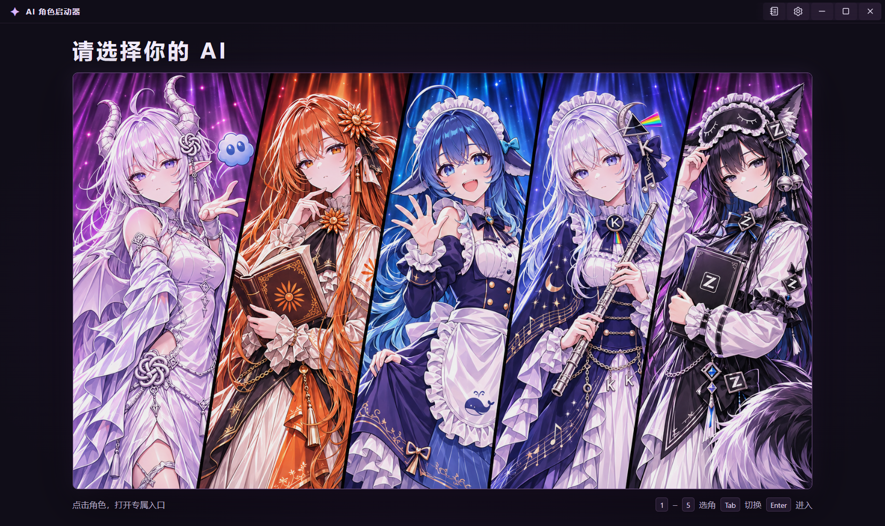
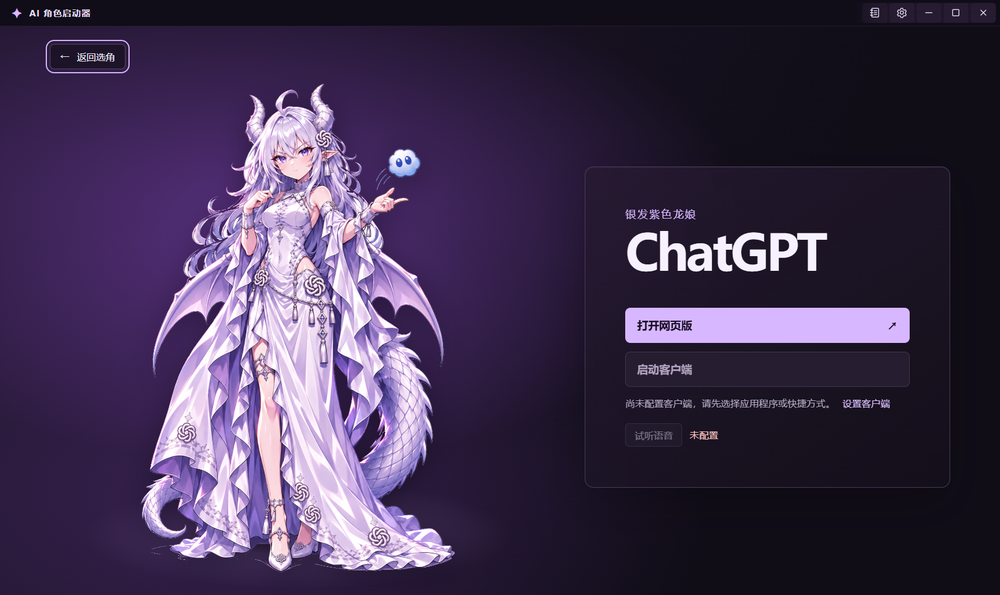
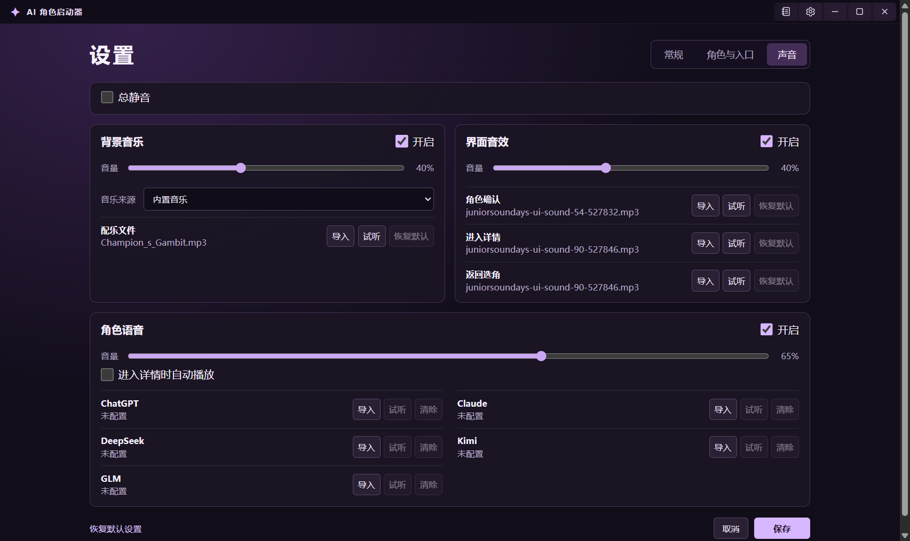

# AI 角色启动器

[**下载 Windows 版（安装包 EXE / 免安装 ZIP）**](https://github.com/JamsonCN/ai-character-launcher/releases/latest)

把常用的 AI 做成一个游戏选角界面。点选 ChatGPT、Claude、DeepSeek、Kimi 或 GLM，就能打开对应的网页版或本机客户端。

## 为什么做这个小软件

最近看了不少「AI 娘」的创作，我就想，能不能把打开 AI 的那一刻做成游戏里的选角界面？每次开始做项目，先选一个今天想并肩作战的角色，再一起把手头的事做下去。这就是我做这个小工具的初衷。

开发时，我借助了 ChatGPT 的 Codex（GPT-6.1 Sol）。应用里的角色图由我参考 ZipZipPipe 的原图二次创作。我把源码公开给大家，欢迎按自己的习惯扩展 AI 角色、换上自己做的立绘和音效，也可以基于这个项目尝试新的角色动画或视频演出。

## 界面预览



| 角色详情 | 声音设置 |
| --- | --- |
|  |  |

## 使用方法

- 在首页点选角色，或按 **1–5** 进入详情。按 **Esc** 返回，按 **F11** 切换全屏。
- 在详情点击 **打开网页版** 或 **启动客户端**。首次使用客户端入口时，到 **设置 → 角色与入口** 选择本机的 `.exe` 或 `.lnk`。角色图、主题色、名称和排序也可在这里修改。
- 在 **设置 → 声音** 调整配乐、界面音效和角色语音。支持导入 MP3 和 WAV，也可以开启总静音。自定义图片、音频、客户端路径和设置保存在本机。
- Windows 版面向 **Windows 10 和 11 x64**。本地验收使用 Windows 11 25H2 x64。安装版从开始菜单打开，也可在 Windows 的 **已安装的应用** 里卸载。免安装版完整解压后双击 `AI Character Launcher.exe`。

## 从源码运行

安装 Node.js 和 npm 后，在项目目录运行：

```powershell
npm ci
npm start
```

在 Windows x64 上运行 `npm run pack:win` 可生成安装 EXE 和免安装 ZIP。直接用仓库源码构建时，应用使用源码自带的合成配乐《幻彩序曲》和界面音效。

GitHub Releases 提供的 **v0.1.1** 成品默认播放《Champion’s Gambit》。滑过角色卡使用 Juniorsoundays 的 `UI Sound 54`，进入详情和返回选角使用 `UI Sound 90`。这些音频随应用使用，可以离线播放。

## 图片署名

**原图来源：ZipZipPipe。应用中的角色图由本人基于原图进行二次创作。** [作者图集《AI娘化》](https://www.pixiv.net/artworks/148186519) · [作者的分享与再创作说明](https://www.bilibili.com/video/BV1bARXBYEZz/)

DeepSeek 鲸鱼娘的原创角色「溟月」来自上善无形，DeepSeek 女仆形象由 ZipZipPipe 二次设计。本项目在该设计上重绘立绘、制作舞台图与动画图层。涉及该角色的立绘、动画图层及展示图依 CC BY-NC-SA 4.0 共享，请保留署名，并用于非商业用途。[原角色出处](https://b23.tv/Kn7yvnF) · [ZipZipPipe 的署名及授权说明](https://www.bilibili.com/video/BV1tE9XBbErS/) · [CC BY-NC-SA 4.0](https://creativecommons.org/licenses/by-nc-sa/4.0/deed.zh-hans)

如果这个启动器让你打开 AI 的过程多了一点乐趣，欢迎给项目点个 **Star**。
